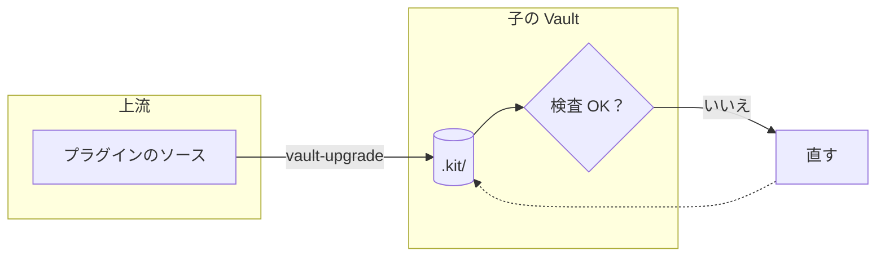

# 図を作る・直す

図は「AI が描いて、人が見る」もの。見やすさは、配置を誰がどう決めるかで決まる（[ADR-0102](../../../.kit/src/docs/adr/0102-diagram-three-methods.md)）。内容に合わせて 3 つの方式から選ぶ。

## 1. 方式を選ぶ

| 方式 | 使う場面 | 置き場所 |
|---|---|---|
| a. Mermaid | 手順・分岐の流れ図、シーケンス図、状態遷移、ガント。ノードは約 12 まで。人がテキストで直すかもしれない図 | ノートの ` ```mermaid ` のコードブロック |
| b. D2 | ノードが多い構成図・関係図で、自動配置でよく、中身がよく変わる図 | `asset/<名前>.d2`（ソース）と `asset/<名前>.svg`（描画） |
| c. SVG を直接書く | 配置に意味がある図（概念図、レイヤー図、比較、マトリクス、説明の一枚）。a・b で思った形にならない図。描いたらあまり変えない図 | `asset/<名前>.svg` |

- 迷ったら a → b → c の順に検討する（作る手間と、直しやすさの順）
- 1 枚に詰め込まない。ノードが 15 を超えそうなら図を分ける
- 以前の Draw.io の図（`.drawio.svg`）は直す手段がない。直すなら、中身を読み取って a〜c で描き直す（下の「以前の Draw.io の図」）

## 2. どの方式でも守ること

- **色は色の名前だけ**: `blue`、`green`、`purple`、`gray`、`sky`、`pink`、`red`、`amber`。値（`#…`）・`style`・テーマの指定を書かない。色はデザイントークンから作ったもの（ライト・ダーク）が付く
- **色は意味で使う**: 例えばグループの区別、データ（`amber`）、外部（`gray`）、注意・差し戻し（`red`）。1 枚に 3〜4 色まで
- **ノートの幅（約 700px）で読める大きさにする**: 横に長くなるなら、向きを変えるか図を分ける。b・c は CLI がノートの幅に縮めたときの文字の大きさを検査し、9px 未満なら警告する
- **ラベルは短く**: ノードは 1〜2 行、1 行は全角で約 12 文字まで。説明は図の外（本文）に書く
- **名前**: 英語のケバブケース（`asset/` 直下。サブフォルダを作らない）。既存の名前と重ならないこと
- **参照**: ``。説明は図の内容を 1 文で（画像が出ない環境で読まれる）。DailyNote（`daily/`）の本文の既存の内容は変えない（追記はよい）
- ブラウザ（Playwright）がある環境では、画像にして見て確かめる（下の「目で確かめる」）

## a. Mermaid

Mermaid は配置を自動で決める。思った形にするには、**配置のエンジンが迷わない書き方**をする。

### 見やすくする書き方

| 工夫 | 書き方 |
|---|---|
| 主な流れを 1 方向にする | 段階・パイプラインは `flowchart LR`、階層・手順は `flowchart TB`。流れに逆らう辺（戻り）は 1〜2 本まで |
| 書く順で並べる | ノードと辺は、流れの順（左上から右下）に書く。同じ段の並びは書いた順になりやすい |
| グループでまとめる | 関係するノードは `subgraph id[ラベル]` に入れる。中の向きは `direction LR` で変えられる |
| 辺を減らす | グループのすべてのノードへ線を引かず、グループの ID へ 1 本引く（`kit --> obs`）。補助の関係は破線 `-.->` にする |
| 交差を減らす | 交差する 2 本の辺は、片方のノードの書く順を入れ替える。それでも交差するなら図を分ける |
| 位置を揃える | 見えない辺 `A ~~~ B` で、つながりのないノードを同じ並びに置く |
| 間を空ける | 長い矢印 `A ---> B`（`-` を増やす）で段を 1 つ飛ばし、ラベルが混まないようにする |
| 形で意味を表す | `[( )]` データ、`{ }` 判断、`([ ])` 始まりと終わり、`[[ ]]` 別の手順、`[/ /]` 入出力 |
| 改行 | ラベルの中は `<br>`。ラベルに記号があれば `"…"` で囲む |

- 色: `A:::blue` か `class A,B blue`（グループにも `class sub blue`）。`classDef`・`style`・`linkStyle`・`%%{init}%%` は書かない（色はスニペット `pkm-theme.css` が付ける）
- シーケンス図は `sequenceDiagram`。参加者は左から登場順に `participant` で並べ、`Note` は `amber` で出る



確かめ方: 書いたらコードブロックを読み直し、辺の数・戻る辺・ラベルの長さが上の目安に収まっているかを見る。mermaid-cli とブラウザがある環境では画像にして見てよい（`tmp/` に置く）。

## b. D2

`asset/<名前>.d2` に書き、CLI で SVG を描く。配置は D2（既定は ELK）が決める。

```sh
node .kit/bin/diagram.mjs d2 asset/<名前>.d2      # asset/<名前>.svg を書く
```

- 色: ノードやグループに `class: blue` を書く。`style.fill` などの色、`vars`・テーマは書かない（CLI が配色のテーマとクラスを前に付ける）
- 向き: 先頭に `direction: right`（段階）か `direction: down`（階層）
- グループ: `name: ラベル { 子: … }`。辺は `a -> b: ラベル`、グループにも引ける（`child.kit -> obs`）。破線は `{ style.stroke-dash: 4 }`
- 形: `shape: cylinder`（データ）、`shape: diamond`（判断）、`shape: hexagon`、`shape: person`、`shape: cloud`、`shape: page`
- `d2` コマンドが要る。なければ CLI が入れ方を出す（`go install oss.terrastruct.com/d2@v0.7.1`。場所は `--d2` か環境変数 `D2_BIN`）。自動配置が合わなければ `--layout dagre` を試し、それでもだめなら c に切り替える
- 直すときは `.d2` を直して、もう一度 `d2` を実行する（SVG を手で直さない）

```d2
direction: right
up: 上流 {
  class: blue
  src: プラグインのソース
}
child: 子の Vault {
  class: green
  kit: .kit/ { shape: cylinder; class: amber }
}
up.src -> child.kit: vault-upgrade
```

## c. SVG を直接書く

配置と線の経路を自分で決めて `asset/<名前>.svg` を書き、CLI でスタイルを差し込む。

```sh
node .kit/bin/diagram.mjs svg-style asset/<名前>.svg   # スタイルと矢印を差し込み、検査を通ったら書く
```

### 決まったクラス（これだけを使う）

| クラス | 付ける要素 | 見た目 |
|---|---|---|
| `node` | 形と文字を囲む `<g>`。形は `<rect>`・`<ellipse>`・`<circle>`・`<polygon>`・`<path>` を `<g>` の直下に置く | 面と枠 |
| `group` | 範囲の `<rect>` と見出しの `<text>` を囲む `<g>` | 薄い面と枠 |
| `edge` | 線の `<path>` | 線と、終わりに矢印。`both` で両端、`plain` で矢印なし |
| `label` | 辺のラベルの `<text>` | 小さい文字。周りを背景の色で縁取り、線の上でも読める |
| `dashed` | `edge`・`node`・`group` に足す | 破線 |
| 色の名前 | `node`・`group`・`edge`・`label`・`<text>` に足す（`class="node blue"`） | その色 |
| `title` / `muted` / `small` / `center` | `<text>` | 太字 / 補助の色 / 11px / 中央揃え（`text-anchor` と縦の中央） |

### 書き方

- ルートは `<svg xmlns="http://www.w3.org/2000/svg" viewBox="0 0 <幅> <高さ>" width="<幅>" height="<高さ>">`。幅は 700 以下を目安にする
- **辺を先に、ノードを後に**書く（線の端がノードの下に隠れる）。線は直交（`H`・`V`）で引き、ほかのノードを横切らない
- 矢印の先は、ノードの縁で止める（縁の 2px 手前）。辺のラベルは線の途中に、`label` を付けて置く
- 文字は `<text>` だけ（`foreignObject` を使わない）。文字の大きさは既定 13px で、`font-size` を書くなら 11 以上
- 書かないもの: 色の値（`fill="#…"`、`style="stroke:…"`）、`<style>`、`<script>`、イベントの属性、外部の画像やフォント
- 等間隔に並べる（間隔は 16 の倍数）。グループの見出しは左上（グループの内側 16px）

```svg
<svg xmlns="http://www.w3.org/2000/svg" viewBox="0 0 520 160" width="520" height="160">
  <g class="group blue"><rect x="8" y="8" width="200" height="144" rx="12"/><text x="24" y="32" class="title">上流</text></g>
  <path class="edge" d="M188,96 H302"/>
  <text x="245" y="84" class="label center">vault-upgrade</text>
  <g class="node"><rect x="28" y="70" width="160" height="52" rx="8"/><text x="108" y="96" class="center">プラグインのソース</text></g>
  <g class="node amber"><rect x="304" y="70" width="160" height="52" rx="8"/><text x="384" y="96" class="center">.kit/</text></g>
</svg>
```

直すときは、`asset/<名前>.svg` の要素（差し込まれた `<style id="pkm-diagram-style">` と `<defs id="pkm-diagram-defs">` の外）を直して、もう一度 `svg-style` を実行する。

## 目で確かめる

ブラウザ（Playwright）がある環境では、b・c の SVG を画像にして見る（`tmp/` に置く。`` に図を読み込んだ HTML のスクリーンショット。ライトとダークの両方。ダークは `colorScheme: "dark"`）。重なり・はみ出し・読めない文字・長すぎる辺・交差があれば直す。検査だけなら:

```sh
node .kit/bin/diagram.mjs svg-check asset/<名前>.svg            # c
node .kit/bin/diagram.mjs svg-check asset/<名前>.svg --allow-colors   # b（D2 の SVG は色の値を持つ）
```

## 以前の Draw.io の図（asset/*.drawio.svg）

Draw.io 関連は除いた（[ADR-0111](../../../.kit/src/docs/adr/0111-remove-drawio.md)）。以前の図は普通の SVG の図として表示・コピーできるが、編集の手段はない。

- 直すよう頼まれたら、図の `<text>` の並びから中身（ノード・つながり・グループ）を読み取り、ユーザーに確かめてから a〜c で描き直す
- 新しい図の名前は `asset/<名前>.svg`（`.drawio.svg` にしない）。参照を新しい図に書き換え、古い図を消すかはユーザーに確かめる（DailyNote の本文の参照は、許可なく書き換えない）

## 図を読み取る

「この図は何？」と聞かれたら:

- Mermaid・D2: ソース（コードブロック、`.d2`）を読む
- SVG: `<text>` と `node` / `edge` の並びから読む。差し込まれたスタイルは読まない

## コミット

- wiki の操作（[LLM wiki の仕組み](../../docs/llm-wiki.md)）の中で新しく作った図は、その操作のコミット（`wiki(…)`）に含めて main に直接コミットしてよい。wiki の操作のコミットでは、`asset/` は追加だけが許される（既存の図は変えられない）。Mermaid はノートの中なので、そのノートの規則に従う
- それ以外（ノートに図を足す、既存の図を直す）は、ブランチで行い PR にする（[進め方](../../docs/workflow.md)）。コミットは `docs(diagram): <要約>`
- `tmp/` の画像や XML はコミットしない（`tmp/` は git で管理しない）

## 外に共有する

図を含むノートを外に渡すときは `node .kit/bin/diagram.mjs export <ノート>` で `tmp/` に書き出す（`asset/` の図を SVG の data URI にして埋め込む。以前の Draw.io の図は編集用 XML を除く）。HTML は `node .kit/bin/html.mjs export <ファイル>` を使う（[ノートの書式と配置](../../docs/vault-conventions.md)）。Mermaid はコードブロックのまま残る（貼り付け先で画像が要るなら、Obsidian で図の PNG をコピーする）。

## 出力の段階

出力は [write-for-reader](../write-for-reader/SKILL.md) に従う。下は既定で、上げ下げはその場で判断する。

| 出力 | 読み手 | 段階 |
|---|---|---|
| 図そのもの | 人 | 2 |
| 作った・直した報告（チャット） | 人 | 1 |
